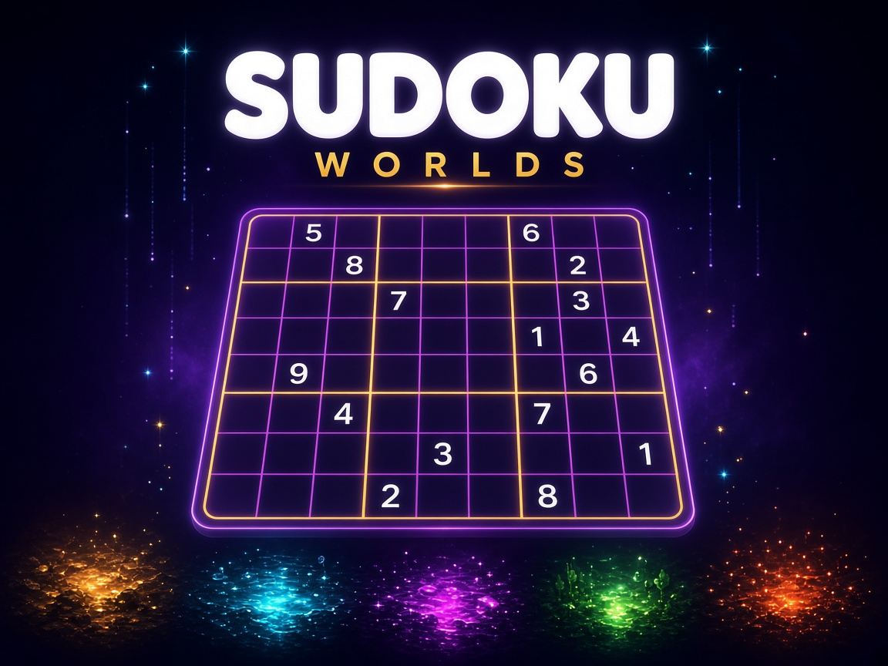

# Sudoku Worlds

A portrait sudoku game. Travel a journey, race the clock, or drop into a world and play.

## Play

Open this folder in Godot 4.7 and press Play. The main scene is `scenes/main.tscn`. The game is laid out for a 720×1280 phone screen.

## Home

- **Journey** continues a run already in progress. **New Game** starts the path over, on Standard or Relaxed pace.
- **Race** is a timed chain of small and wide puzzles.
- **Quickplay** deals a random world and difficulty.
- **Worlds** opens Desert, Water, Neon, Forest, Ember, or Rain.

Journey walks five worlds, three stages each. Rain stays in the Worlds list. Stars from journey clears add up on the ranks page, from Novice to Sudoku Master.
